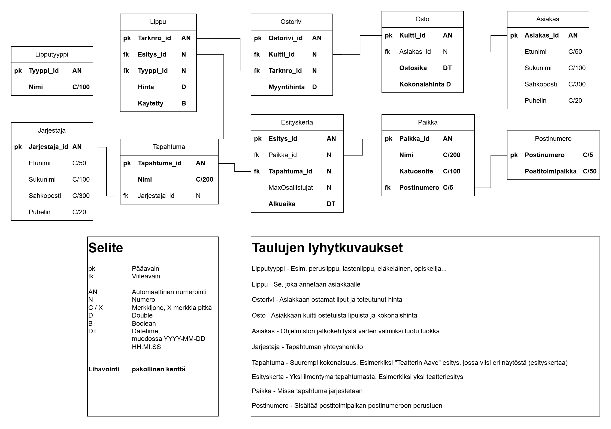

# TicketGuru -lipunmyyntijärjestelmä


Tiimi Ykköset: <br>
Oksanen Joonis <br>
Paavolainen Arttu <br>
Salminen Sini <br>
Vastamäki Johanna <br>
Vähäkuopus Felix

## Johdanto


### Opintojakso
Tämä projekti on toteutettu Haaga Helian opintojaksolle Ohjelmistoprojekti 1 - SOF005AS3A-3026 syksyllä 2026. Opintojakson tavoitteena on, että opiskelijat toimivat ohjelmistoprojektin kehitystiimin jäsenenä, toteuttavat ohjelmistorajapinnan ja tekevät yhteistyötä tilaajatahon (opettaja) kanssa. Opintojakso kestää 16 viikkoa, jonka aikana ohjelmistoprojekti kehitetään.

### Tilaaja
Projektissa tilaajana on lipputoimisto, joka tilaa tiimiltä lipunmyyntijärjestelmän (TicketGuru). Järjestelmältä halutaan mm.
* Toimisto voi määritellä itse tapahtumat
* Tukevan eri lipputyyppejä (esim. aikuinen, lapsi, eläkeläinen) eri hinnoilla
* Hintoja voidaan muokata ohjelmassa
* Pystytään tarkastella myyntiraporttia ja myyntitapahtumia
* Lipunmyyntipisteessä voidaan tulostaa liput järjestelmän kautta
* Lippuihin tulostetaan tarkistuskoodi
* Mahdollinen verkkokauppa, jotta asiakkaat pystyvät omatoimisesti ostamaan lippuja


### Toteutus- ja toimintaympäristö
Projektin tietokantana toimii SQL ja tietokannan käyttöliittymänä käytämme PostgreSQL:ää. Käytämme projektissa myös REST-ohjelmistorajapintaa Back end ja Front end -osien välillä. Ohjelmiston kehitettämiseen käytetään Spring Boot -sovelluskehystä. Front end tekniikkana toimii React.
Julkaisemme lopputuloksen toimimaan verkkosivulla.


### Lopputulos
Lopputuloksena projektille on tilaajan toiveiden mukainen tuote, jota voi käyttää tietokoneella.

<!-- Johdantoon kirjoitetaan lyhyt, ytimekäs kuvaus siitä, mikä on projektin aihe,
kuka on asiakas (käyttäjä), mitä hän haluaa ja saa järjestelmältä, mitä
tekniikoita käytetään ja mitä konkreettisesti on valmiina, kun projekti päättyy.

-   Järjestelmän tarkoitus ja tiivis kuvaus siitä, mistä on kyse ja kenelle järjestelmä on tarkoitettu.
-   Toteutus- ja toimintaympäristö lyhyesti:  
    -   Palvelinpuolen ratkaisut ja teknologiat (esim. palvelinteknologia, mikä tietokantajärjestelmä on käytössä)
    -   Käyttöliittymäratkaisut ja teknologiat (esim. päätelaitteet: puhelin,
    täppäri, desktop)
-->

## Järjestelmän määrittely
Järjestelmän määrittely kuvaa käyttäjän näkökulmasta järjestelmän keskeiset toiminnot. Käyttäjäroolit määrittelevät järjestelmää käyttävät ryhmät, ja käyttäjätarinat listaa erilaisia käyttötapauksia. Käyttötapauskaavio esittää keskeiset toiminteet järjestelmälle, jakaen ne käyttäjien vastuiden mukaisesti: mitä eri toiminteita eri käyttäjäryhmät järjestelmällä tekevät.

### Käyttäjäroolit

#### Asiakas
Henkilö joka voi ostaa lipun haluamaansa tapahtumaan lipiunmyyntipisteestä tai verkkokaupasta.

Roolin käyttötapaukset:
* Tapahtumien selaaminen
* Lipun ostaminen
* Lipputyypin valinta
* Maksaminen
* Digitaalisen lipun vastaanottaminen
* Lipun palautus/vaihto

#### Lipunmyyjä
Lipputoimiston työntekijä, joka myy ja hallinnoi lippuja asiakkaille. Järjestelmän operatiivinen käyttäjä.

Roolin käyttötapaukset:
* Lippujen myynti
* Lippujen tulostaminen
* Tapahtumien ja hintojen hallinta
* Myyntiraporttien tarkastelu

#### Lipuntarkastaja
Tapahtuman ovella työskentelevä henkilö, joka tarkistaa asiakkaiden liput sisäänpääsyn yhteydessä.

Roolin käyttötapaukset:
* Lipun koodin lukeminen
* Lipun aitouden ja voimassaolon tarkistaminen
* Lippujen merkitseminen käytetyiksi

#### Tapahtumajärjestäjä
Tapahtuman järjestäjä, joka on kiinnostunut oman tapahtumansa tiedoista ja myyntiraportista.

Roolin käyttötapaukset:
* Tapahtuman tietojen ja myyntitilastojen tarkastelu (kävijämäärät, myytyjen lippujen määrät ja tuotot)

<br>

### Käyttäjätarinat

## Vaihe 1: Perusta

#### Tarina 8: Tapahtuman tietojen ja hintojen hallinta
Lipputoimiston työntekijä saa tiedon, että tapahtumajärjestäjä on muuttanut tulevan tapahtuman lippujen hintoja. Aikuisten lipun hinta nousee 20 eurosta 25 euroon ja lasten lipun hinta 10 eurosta 12 euroon. Työntekijä kirjautuu lipunmyyntijärjestelmään ja päivittää tapahtuman hinnat sekä muut tarvittavat tapahtumatiedot. Järjestelmä tallentaa muutokset, minkä jälkeen asiakkaat näkevät verkkokaupassa uudet hinnat ja järjestelmä laskee ostoksen loppusumman niiden perusteella.

---

## Vaihe 2: Ydinvirta

#### Tarina 7: Lipun ostaminen verkosta
Asiakas haluaa ostaa lipun tulevana viikonloppuna järjestettävään tapahtumaan. Hän avaa lipputoimiston verkkosivut ja valitsee haluamansa tapahtuman sekä näytöksestä vapaan paikan. Asiakas valitsee aikuisten lipun, maksaa ostoksen verkkopankissa ja saa onnistuneen maksun jälkeen sähköpostiinsa vahvistuksen sekä digitaalisen lipun. Lipussa näkyvät tapahtuman tiedot ja yksilöllinen koodi, jonka hän voi näyttää puhelimestaan tapahtuman ovella. Asiakkaan ei näin tarvitse käydä lipunmyyntipisteellä tai tulostaa lippua etukäteen.

#### Tarina 3: Lipun tulostus
Lipunmyyjänä haluan, että jokaiselle myydylle lipulle tulostuu automaattisesti fyysinen lippu, jossa näkyy tapahtuman tiedot sekä yksilöllinen, helposti luettava koodi, jotta asiakas saa mukaansa toimivan pääsylipun heti oston yhteydessä. Tulostuksen tulisi onnistua sekä ennakkomyynnissä että tapahtumapäivänä ovella tapahtuvassa myynnissä. Haluan myös, että tulostusvirheen sattuessa lippua voidaan tulostaa uudelleen ilman, että asiakkaalta veloitetaan kahdesti tai että järjestelmään syntyy virheellisiä kaksoiskappaleita samasta lipusta.

#### Tarina 4: Lipun tarkastus ovella
Ovella työskentelevänä henkilönä haluan lukea lipussa olevan koodin järjestelmän avulla, jotta näen välittömästi, onko lippu aito, oikeaan tapahtumaan kuuluva ja vielä käyttämätön. Kun lippu todetaan kelvolliseksi, haluan pystyä merkitsemään sen käytetyksi yhdellä toiminnolla, jotta samaa lippua ei voida käyttää uudelleen sisäänpääsyyn. Mikäli lippu on jo käytetty tai virheellinen, haluan järjestelmän ilmoittavan siitä selkeästi, jotta voin estää asiakkaan pääsyn ja toimia tilanteen vaatimalla tavalla.

#### Tarina 1: Saman päivän esitys
Kaverukset Christian ja Laura haluavat mennä Teatterin Aave -esitykseen perjantaina. Perjantaina heidän saapuessaan lipunmyynnille myyjä kertoo, että päivä on loppuunmyyty eikä lippuja kyseiselle päivälle enää ole. Myyjä kertoo, että ensi viikon lauantaina on vielä paikkoja jäljellä. Kaverukset ostavat liput lauantain esitykseen jotka saavat heti tulostettuna, ja joutuvat keksimään muuta tekemistä illalleen. <br>
Seuraavana lauantaina Christian ja Laura saapuvat ajallaan esitykseen. Ovella valvoja tarkistaa liput, ja merkitsee ne käytetyksi kavereiden mennessä sisään.

---

## Vaihe 3: Eheys

#### Tarina 5: Tungos ja tuplaliput
Lipputoimisto sai ison tapahtumajärjestäjän asiakkaakseen. Tapahtuman suosio yllätti ja liput myytiin hetkessä loppuun. Ongelmaksi koitui, ettei myydyt liput päivittyneet reaaliajassa eri lipunmyyntipisteisiin, jolloin tapahtumaan myytiin liikaa lippuja. Seurauksena tilojen enimmäismäärä ylittyi. Tapahtuma sai huonoa palautetta tungoksesta, josta seurasi muitakin käytännön ongelmia. Lisäksi asiakkaille oli tulostunut tuplalippuja samoilla sarjanumeroilla. Osa asiakkaista ei päässyt paikalle ja he myivät alkuperäisiä lippujaan yksityisesti eteenpäin ennen tapahtumaa. Tapahtumapäivänä ovella oli paljon selvittelyä, oliko eteenpäin myydyt liput väärennettyjä vai alkuperäisiä ”tuplalippuja”. Tämä hidasti kaikkien sisäänpääsyä sekä lisäsi pahaa mieltä ja mainehaittaa lipputoimistolle.

---

## Vaihe 4: Tuki

#### Tarina 9: Aiemman ostoksen etsiminen
Lipunmyyjä saa asiakkaalta kyselyn aikaisemmin ostetusta lipusta. Asiakas ei löydä lippuaan eikä muista, milloin ostos on tehty. Lipunmyyjä etsii järjestelmästä asiakkaan ostoksen esim. tietyn tapahtuman ostotietojen perusteella. Järjestelmä näyttää löydetyn ostoksen tiedot, jolloin myyjä voi tarkistaa lipun tilanteen ja tarvittaessa auttaa asiakasta.

#### Tarina 6: Peruutusoikeus
Asiakas on ostanut lipun tapahtumaan Syysyö Sastamalassa. Alkusyksystä hän kuitenkin loukkaantuu tapaturmaisesti. Saattajan avustamana sekä raajat kipsattuna hän lähtee käymään lipunmyyntipisteellä, koska he eivät löydä mahdollisuutta asioida netin kautta, eikä puhelimitsekaan oikein osattu auttaa, että mitä lipun kanssa voisi nyt tehdä. Asiakas näyttää lipunmyyntipisteellä lääkärintodistuksen sekä ostamansa paperisen lipun. Hän toivoisi, että saisi lippua vastaan rahat takaisin taikka vaihtaa lipun toiseen, myöhemmin tulevaan tapahtumaan. Lipunmyyntipisteellä henkilökunta ei oikein tiedä miten lipun kanssa kuuluisi toimia, kun ei ole lipunmyyntijärjestelmääkään, jonne voisi kirjata lipun palautuneeksi. Lopulta he ottavat lipun kuitenkin takaisin myyntiin ja antavat samanhintaisen, tulevan tapahtuman lipun tilalle. He pahoittelevat, että asiakas joutui asian vuoksi tulemaan fyysisesti paikan päälle. Asiakas on tyytyväinen, että asia hoitui parhain päin, mutta olisi halunnut mieluummin asioida verkossa.

---

## Vaihe 5: Raportointi

#### Tarina 10: Tapahtuman tietojen seuranta
Tapahtumajärjestäjä haluaa nähdä, kuinka paljon tapahtumaan on vielä vapaita paikkoja ja kuinka monta lippua on jo myyty. Hän pääsee katsomaan näitä tilastoja tapahtumajärjestäjälle jaetun linkin kautta. Linkin kautta avautuu näkymä järjestelmän tietoihin kyseisestä tapahtumasta ja siihen liittyvistä tilastoista. Tapahtumajärjestäjä on tyytyväinen toiminnallisuuteen, koska hän pääsee tutkimaan ajankohtaista dataa.

#### Tarina 2: Tapahtuman kannattavuus
Erään tapahtumahallin omistaja pohtii, kannattaako Kuukauden Kirja -tapahtumaa järjestää enää. Päätöksensä tueksi hän haluaa tietää, kuinka monta kävijää edellisessä tapahtumassa on ollut ja kuinka paljon tapahtuma on tienannut, jotta voi verrata niitä tapahtuman järjestämisestä aiheutuviin kuluihin. <br>
Omistaja ottaa yhteyttä lipputoimistoon jonka kautta liput myydään ja tahtoo tietää tapahtuman tilastot. Lipputoimiston työntekijä selvittää järjestelmästään Kuukauden kirja -tapahtumaan myytyjen lippujen myyntiraportin ja osaa kertoa, että tapahtumaan ostettiin 314 aikuisten lippua ja 42 lasten lippua. Näin ollen tuottoja oli yhteensä 4020 euroa. Tämän perusteella omistaja voi pohtia, kannattaako tapahtumaa enää järjestää vai olisiko mahdollista lisätä tapahtuman houkuttelevuutta.

### Käyttötapauskaavio


<!-- Määrittelyssä järjestelmää tarkastellaan käyttäjän näkökulmasta. Järjestelmän
toiminnot hahmotellaan käyttötapausten tai käyttäjätarinoiden kautta, ja kuvataan järjestelmän
käyttäjäryhmät.

-   Lyhyt kuvaus käyttäjäryhmistä (rooleista)
-   Käyttäjäroolit ja roolien tarvitsemat toiminnot, esim. käyttötapauskaaviona
    (use case diagram) tai käyttäjätarinoina.
-   Lyhyt kuvaus käyttötapauksista tai käyttäjätarinat

Kuvauksissa kannattaa harkita, mikä on toteuttajalle ja asiakkaalle oleellista
tietoa ja keskittyä siihen.  -->

 

## Käyttöliittymä

### Alkuperäinen suunnitelma


### Toteutunut käyttöliittymä

Käyttöliittymä on toteutettu React-sovelluksena (Vite, React Router ja MUI-komponenttikirjasto). Se kommunikoi taustajärjestelmän REST-rajapinnan kanssa Basic-tunnistautumisella. Tunnukset luetaan ympäristömuuttujista `VITE_LIPPU_USER` ja `VITE_LIPPU_PASSWORD`.

Näkymät ja siirtymät:

```text
              Valikko (hampurilaisvalikko, TicketGuru)
                  │
   ┌──────────────┼───────────────┐
   ▼              ▼               ▼
Etusivu (/)   Myynti (/myynti)  Tarkistus (/tarkistus)
   │              ▲
   └─ "Myy lippuja" (valitun tapahtuman tiedot mukana)

Tuntematon osoite → Virhe-näkymä
```

#### Valikko

Sivun yläreunassa on palkki, jossa on TicketGuru-nimi ja hampurilaisvalikko. Valikosta pääsee näkymiin Etusivu, Tarkistus ja Myynti.

#### Etusivu (`/`)

Etusivulla listataan kaikki tapahtumat tapahtumakortteina. Kortissa näkyvät tapahtuman tulevat esityskerrat (aika, paikka, osoite, postinumero ja enimmäisosallistujamäärä). Hakukenttä "Hae tapahtumaa nimellä" suodattaa tapahtumia kirjoittaessa. Jos hakua vastaavia tapahtumia ei ole, näytetään teksti "Ei tapahtumia.".

#### Myynti (`/myynti`)

Myyntinäkymä lippujen myyntiin:

- Tapahtuma- ja Esityskerta-pudotusvalikoilla rajataan näytettävät liput. "Poista valinnat" -painike tyhjentää rajaukset.
- Esityskerran liput näytetään lippukortteina (aika, tapahtuman nimi, lipputyyppi, sarjanumero ja hinta). Lipun voi lisätä myyntilistalle "Myy lippu" -painikkeella. Jo myyty lippu on merkitty myydyksi eikä sitä voi lisätä uudelleen.
- Yhteenvetorivillä näkyy rajauksen mukainen myytyjen lippujen määrä, kokonaismäärä ja myyntisumma.
- Myyntilista kokoaa valitut liput ja näyttää yhteissumman. Lipun voi poistaa listalta "Poista"-painikkeella.
- "Suorita maksu" merkitsee listan liput ostetuiksi (`PATCH /api/liput/{id}/ostettu`) ja tallentaa ostotapahtuman (`POST /api/ostot`), johon tulee yksi ostorivi jokaista lippua kohden. Jos jonkin lipun käsittely epäonnistuu, se jää myyntilistalle ja virhe näytetään.
- "Osto historia" avaa ikkunan, jossa listataan tehdyt ostotapahtumat (`GET /api/ostot`).
- "Palauta kaikki ostamattomiksi" palauttaa kaikki ladatut ostetut liput takaisin myyntiin (`PATCH /api/liput/{id}/ostamaton`). Toiminto kysyy ensin vahvistuksen.

#### Tarkistus (`/tarkistus`)

Tarkistusnäkymä on lipuntarkastajan työkalu ovella. Käyttäjä kirjoittaa tai liittää lipun sarjanumeron (36 merkkiä, UUID) hakukenttään, ja haku tehdään automaattisesti, kun sarjanumero on täysi.

- Jos lippu löytyy, kentän alle tulee teksti "Lippu löytyi!" ja näkyviin lippukortti (esitysaika, sarjanumero, lipputyyppi ja hinta).
- Jos lippua ei löydy, näytetään "Lippua ei löytynyt". Muu virhe näytetään tekstillä "Haku epäonnistui".
- Lippukortin kytkimellä lippu merkitään käytetyksi (punainen, KÄYTETTY) tai käyttämättömäksi (vihreä, KÄYTTÄMÄTÖN). Muutos tallentuu heti rajapintaan (`PATCH /api/liput/{id}/kaytetty` tai `/kayttamaton`) ja onnistumisesta näytetään ilmoitus "Tiedot tallennettu!". Jos tallennus epäonnistuu, kytkin palautuu edelliseen tilaan ja näytetään virheilmoitus.

#### Virhenäkymä

Jos käyttäjä siirtyy osoitteeseen, jota ei ole, näytetään teksti "Kyseistä sivua ei ole".

-----

## Tietokanta

### Tietokantakaavio



### Tietohakemisto

> ### _Lipputyyppi_
> _Lipputyyppi-taulu sisältää eri lipputyypit, kuten peruslippu, eläkeläinen, lastenlippu, opiskelija... Yhdellä lipulla voi olla vain yksi lipputyyppi, mutta yhdellä lipputyypillä voi olla monta eri lippua._
>
> Kenttä | Tyyppi | Kuvaus
> ------ | ------ | ------
> Tyyppi_id | int PK (identity) | Lipputyypin id
> Nimi | varchar(100) |  Lipputyypin nimi (Peruslippu, lastenlippu..)

> ### _Lippu_
> _Lippu-taulu sisältää liput esityskerroille. Yhdellä lipulla voi olla vain yksi esityskerta, mutta esityskerralla on monta erilaista lippua. Lipun tunniste on järjestelmän generoima UUID, joka toimii lipun sarjanumerona ja QR-koodin sisältönä._
>
> Kenttä | Tyyppi | Kuvaus
> ------ | ------ | ------
> Tark_nro | UUID PK (generoitu) | Lipun yksilöivä sarjanumero (tarkistusnumero)
> Esityskerta_id | int FK |  Mihin esityskertaan lippu on
> Lipputyyppi_id | int FK | Mikä lipputyyppi lippu on
> Hinta | numeric(10,2) | Lipun kappalehinta
> Kaytetty | boolean | Onko lippu käytetty (merkitään tarkastuksessa)
> Ostettu | boolean | Onko lippu myyty asiakkaalle

> ### _Ostorivi_
> _Ostorivi-taulu yhdistää ostetut liput ja ostotapahtuman. Ostorivillä voi olla monta eri lippua, mutta yhdellä lipulla voi olla vain yksi ostorivi, eli ostokerta._
>
> Kenttä | Tyyppi | Kuvaus
> ------ | ------ | ------
> Ostorivi_id | int PK (identity) | Ostorivin id
> Kuitti_id | int FK |  Mihin ostoon ostorivi kuuluu
> Tarknro_id | int FK | Mikä lippu on ostettu
> Myyntihinta | numeric(10,2) | Lipun toteutunut (kappale)hinta

> ### _Osto_
> _Osto-taulu vastaa asiakkaan kuittia, eli yhtä ostotapahtumaa. Yhdellä ostolla voi olla monta ostoriviä, mutta yksi ostorivi voi kuulua vain yhteen ostotapahtumaan._
>
> Kenttä | Tyyppi | Kuvaus
> ------ | ------ | ------
> Kuitti_id | int PK (identity) | Kuitin id
> Asiakas_id | int FK |  Kuka oli ostaja
> Ostoaika | timestamp | Milloin ostettiin: pvm ja klo
> Kokonaishinta | numeric(10,2) | Oston kokonaishinta

> ### _Asiakas_
> _Asiakas-taulu on valmiiksi luotu luokka jatkokehitystä ajatellen. Asiakkaalla voi olla monta ostoa, mutta yhdellä ostolla voi olla vain yksi asiakas/ostaja._
>
> Kenttä | Tyyppi | Kuvaus
> ------ | ------ | ------
> Asiakas_id | int PK (identity) | Asiakkaan id
> Etunimi | varchar(50) |  Asiakkaan etunimi
> Sukunimi | varchar(100) |  Asiakkaan sukunimi
> Sähköposti | varchar(300) | Asiakkaan sähköpostiosoite
> Puhelin | varchar(20) | Asiakkaan puhelinnumero

> ### _Jarjestaja_
> _Jarjestaja-taulu sisältää tapahtuman yhteyshenkilön. Tarkoituksena on, että yhdellä tapahtumalla on vain yksi päävastuuhenkilö/järjestäjä. Järjestäjällä voi olla monta tapahtumaa._
>
> Kenttä | Tyyppi | Kuvaus
> ------ | ------ | ------
> Jarjestaja_id | int PK (identity) | Järjestäjän id
> Etunimi | varchar(50) |  Järjestäjän etunimi
> Sukunimi | varchar(100) |  Järjestäjän sukunimi
> Sähköposti | varchar(300) | Järjestäjän sähköpostiosoite
> Puhelin | varchar(20) | Järjestäjän puhelinnumero

> ### _Tapahtuma_
> _Tapahtuma-taulu sisältää tapahtuman tiedot. Yhdellä tapahtumalla voi olla monta esityskertaa, mutta yksi esityskerta voi kuulua vain yhteen tapahtumaan._
>
> Kenttä | Tyyppi | Kuvaus
> ------ | ------ | ------
> Tapahtuma_id | int PK (identity) | Tapahtuman id
> Nimi | varchar(200) |  Tapahtuman nimi
> Jarjestaja_id | int FK |  Tapahtuman järjestäjä

> ### _Esityskerta_
> _Esityskerta-taulu sisältää tapahtuman yhden esityksen sekä sen tapahtumapaikan, max. osallistujamäärän ja alkamisajan. Yksi esitys voi tapahtua vain yhdessä paikassa, mutta yhdellä paikalla voi olla monta esityskertaa._
>
> Kenttä | Tyyppi | Kuvaus
> ------ | ------ | ------
> Esitys_id | int PK (identity) | Esityskerran id
> Paikka_id | int FK |  Missä esitys järjestetään
> Tapahtuma_id | int FK |  Mihin tapahtumaan esityskerta kuuluu
> MaxOsallistujat | int | Esityksen maksimi osallistujamäärä
> Alkuaika | timestamp | Mikä päivä ja mihin aikaan esitys alkaa

> ### _Paikka_
> _Paikka-taulu sisältää esityskerran tapahtumapaikan osoitetietoineen._
>
> Kenttä | Tyyppi | Kuvaus
> ------ | ------ | ------
> Paikka_id | int PK (identity) | Paikan id
> Nimi | varchar(200) |  Paikan nimi
> Katuosoite | varchar(100) |  Paikan katuosoite
> Postinumero | varchar(5) FK | Paikan postinumero

> ### _Postinumero_
> _Postinumero-taulu sisältää postinumerolla löytyvän postitoimipaikan. Yhdellä postinumerolla on vain yksi postitoimipaikka. Yhdellä postitoimipaikalla voi olla monta postinumeroa._
>
> Kenttä | Tyyppi | Kuvaus
> ------ | ------ | ------
> Postinumero | varchar(5) PK | Yksilöivä postinumero
> Postitoimipaikka | varchar(50) |  Postitoimipaikan nimi


<!--
Järjestelmään säilöttävä ja siinä käsiteltävät tiedot ja niiden väliset suhteet
kuvataan käsitekaaviolla. Käsitemalliin sisältyy myös taulujen välisten viiteyhteyksien ja avainten
määritykset. Tietokanta kuvataan käyttäen jotain kuvausmenetelmää, joko ER-kaaviota ja UML-luokkakaaviota.

Lisäksi kukin järjestelmän tietoelementti ja sen attribuutit kuvataan
tietohakemistossa. Tietohakemisto tarkoittaa yksinkertaisesti vain jokaisen elementin (taulun) ja niiden
attribuuttien (kentät/sarakkeet) listausta ja lyhyttä kuvausta esim. tähän tyyliin:

> ### _Tilit_
> _Tilit-taulu sisältää käyttäjätilit. Käyttäjällä voi olla monta tiliä. Tili kuuluu aina vain yhdelle käyttäjälle._
>
> Kenttä | Tyyppi | Kuvaus
> ------ | ------ | ------
> id | int PK | Tilin id
> nimimerkki | varchar(30) |  Tilin nimimerkki
> avatar | int FK | Tilin avatar, viittaus [avatar](#Avatar)-tauluun
> kayttaja | int FK | Viittaus käyttäjään [käyttäjä](#Kayttaja)-taulussa -->

## Tekninen kuvaus

### REST-rajapinnan kuvaus

## Yleiskuvaus

TicketGuru-järjestelmän REST-rajapinta on toteutettu Java-ohjelmointikielellä käyttäen Spring Boot -sovelluskehystä. Rajapinnan tehtävänä on tarjota käyttöliittymälle ja mahdollisille ulkoisille järjestelmille pääsy tapahtuma- ja järjestäjätietoihin HTTP-protokollan välityksellä.

Rajapinta noudattaa REST-arkkitehtuurityyliä, jossa resurssit esitetään URL-osoitteina ja operaatioiden suorittamiseen käytetään HTTP-metodeja (GET, POST, PUT ja DELETE). Tietojen vaihto tapahtuu JSON-muodossa.

Tietojen tallennus toteutetaan SQL-tietokantaan Spring Data JPA -kirjaston avulla. Controller-luokat vastaanottavat HTTP-pyynnöt ja välittävät tietokantaoperaatiot repository-kerrokselle.

## Arkkitehtuuri

```text
Käyttäjä / selain
        │
        │ HTTP / HTTPS
        ▼
Spring Boot REST API
        │
        │ Spring Data JPA
        ▼
SQL-tietokanta
```

Rajapinnan toteutuksessa käytetään seuraavia teknologioita:

- Java
- Spring Boot
- Spring Web
- Spring Data JPA
- SQL-tietokanta
- Maven

---

# Järjestäjärajapinta

## Perusosoite

```http
/ticketguru/jarjestajat
```

Järjestäjärajapinnan avulla voidaan hakea, lisätä ja yksittäistapauksissa hakea järjestäjätietoja tietokannasta.

---

## Hae kaikki järjestäjät

Palauttaa kaikki järjestelmään tallennetut järjestäjät.

### Pyyntö

```http
GET /ticketguru/jarjestajat
```

### Esimerkkivastaus

```json
[
  {
    "etunimi": "Matti",
    "sukunimi": "Halminen",
    "sahkoposti": "matin@kukat.fi",
    "puhelin": "0401234567"
  },
  {
    "etunimi": "Tom",
    "sukunimi": "Aatti",
    "sahkoposti": "tom.aatti@gmail.com",
    "puhelin": "0407654321"
  },
  {
    "etunimi": "Naami",
    "sukunimi": "Puronen",
    "sahkoposti": "NewKirjailijaliitto@liitto.fi",
    "puhelin": "0501234567"
  }
]
```

### Toteutus

```java
@GetMapping
public List<Jarjestaja> getAlljarjestajat()
```

---

## Hae yksittäinen järjestäjä

Palauttaa yhden järjestäjän tunnisteen perusteella.

### Pyyntö

```http
GET /ticketguru/jarjestajat/{id}
```

### Esimerkki

```http
GET /ticketguru/jarjestajat/1
```

### Esimerkkivastaus

```json
{
  "etunimi": "Matti",
  "sukunimi": "Halminen",
  "sahkoposti": "matin@kukat.fi",
  "puhelin": "0401234567"
}
```

---

## Lisää uusi järjestäjä

Tallentaa uuden järjestäjän tietokantaan.

### Pyyntö

```http
POST /ticketguru/jarjestajat
```

### Pyynnön sisältö

```json
{
  "nimi": "Rock Events Oy"
}
```

### Esimerkkivastaus

```json
{
  "id": 3,
  "nimi": "Rock Events Oy"
}
```

### Toteutus

```java
@PostMapping
public Jarjestaja addJarjestaja(
        @RequestBody Jarjestaja uusiJarjestaja)
```

---

# Tapahtumarajapinta

## Perusosoite

```http
/ticketguru/tapahtumat
```

Tapahtumarajapinta tarjoaa toiminnot tapahtumien hakemiseen, päivittämiseen ja poistamiseen.

---

## Hae kaikki tapahtumat

Palauttaa kaikki tietokannassa olevat tapahtumat.

### Pyyntö

```http
GET /ticketguru/tapahtumat
```

### Esimerkkivastaus

```json
[
  {
    "nimi": "Keikkakeidas",
    "esityskerrat": [],
    "id": 1,
    "jarjestaja": null
  },
  {
    "nimi": "Teatterin Aave",
    "esityskerrat": [],
    "id": 2,
    "jarjestaja": null
  },
  {
    "nimi": "Vantaan kirjamessut",
    "esityskerrat": [],
    "id": 3,
    "jarjestaja": null
  }
]
```

### Toteutus

```java
@GetMapping
public List<Tapahtuma> getAllTapahtumat()
```

---

## Hae yksittäinen tapahtuma

Palauttaa yhden tapahtuman tunnisteen perusteella.

### Pyyntö

```http
GET /ticketguru/tapahtumat/{id}
```

### Esimerkki

```http
GET /ticketguru/tapahtumat/1
```

### Esimerkkivastaus

```json
{
  "nimi": "Keikkakeidas",
  "esityskerrat": [],
  "id": 1,
  "jarjestaja": null
}
```

---

## Hae tapahtuman kaikki liput

Palauttaa tapahtuman kaikki liput ryhmiteltynä esityskerroittain. Vastaus on JSON-olio, jossa avaimena on esityskerran id ja arvona kyseisen esityskerran liput.

### Pyyntö

```http
GET /api/tapahtumat/{id}/liput
```

### Esimerkki

```http
GET /api/tapahtumat/2/liput
```

### Esimerkkivastaus

```json
{
  "4": [
    {
      "id": "5bc04a8b-c2ee-4337-95f8-ac9846fe3151",
      "hinta": 10,
      "kaytetty": false,
      "ostettu": false,
      "lipputyyppi": { "id_": 1, "nimi_": "Lastenlippu" },
      "esityskerta": { "id": 4, "alkuaika": "2026-12-12T13:00:00.000+00:00", "maxOsallistujat": 100, "paikka": null }
    }
  ],
  "5": []
}
```

Jos tapahtumaa ei löydy annetulla tunnisteella, vastaus on tyhjä (`null`).

### Toteutus

```java
@GetMapping("/{id}/liput")
public Map<Long, List<Lippu>> getLiputByTapahtuma(@PathVariable Long id)
```

---

## Hae esityskerran kaikki liput

Palauttaa yhden tapahtuman yhden esityskerran kaikki liput listana. Käyttöliittymän myyntinäkymä hakee liput tällä rajapinnalla jokaiselle esityskerralle.

### Pyyntö

```http
GET /api/tapahtumat/{tapahtumaId}/{esityskertaId}/liput
```

### Esimerkki

```http
GET /api/tapahtumat/2/4/liput
```

### Esimerkkivastaus

```json
[
  {
    "id": "5bc04a8b-c2ee-4337-95f8-ac9846fe3151",
    "hinta": 10,
    "kaytetty": false,
    "ostettu": false,
    "lipputyyppi": { "id_": 1, "nimi_": "Lastenlippu" },
    "esityskerta": { "id": 4, "alkuaika": "2026-12-12T13:00:00.000+00:00", "maxOsallistujat": 100, "paikka": null }
  }
]
```

Lippu palautetaan vain, jos esityskerta kuuluu annettuun tapahtumaan. Muussa tapauksessa palautetaan tyhjä lista.

### Toteutus

```java
@GetMapping("/{tapahtumaId}/{esityskertaId}/liput")
public List<Lippu> getLiputByEsityskerta(
        @PathVariable Long tapahtumaId,
        @PathVariable Long esityskertaId)
```

-----

## Päivitä tapahtuma

Päivittää olemassa olevan tapahtuman tiedot.

### Pyyntö

```http
PUT /ticketguru/tapahtumat/{id}
```

### Esimerkki

```http
PUT /ticketguru/tapahtumat/1
```

### Pyynnön sisältö

```json
{
  "nimi": "Summer Festival 2025"
}
```

### Esimerkkivastaus

```json
{
  "nimi": "Summer Festival 2025",
  "id": 1
}
```

### Toteutus

```java
@PutMapping("/{id}")
public Tapahtuma updateTapahtuma(
        @PathVariable Long id,
        @RequestBody Tapahtuma updateTapahtuma)
```

---

## Poista tapahtuma

Poistaa tapahtuman tietokannasta.

### Pyyntö

```http
DELETE /ticketguru/tapahtumat/{id}
```

### Esimerkki

```http
DELETE /ticketguru/tapahtumat/1
```

### Esimerkkivastaus

Poistamisen jälkeen palvelu palauttaa päivitetyn tapahtumalistan.

```json
[
  {
    "id": 2,
    "nimi": "Rock Festival"
  }
]
```

### Toteutus

```java
@DeleteMapping("/{id}")
public List<Tapahtuma> deleteTapahtuma(
        @PathVariable Long id)
```

---

# Lippurajapinta

## Perusosoite

```http
/api/liput
```

Lippurajapinnan avulla saadaan lisättyä ja muokattua lippuja tietokannassa

## Hae lippu
```http
GET /api/liput
```
### Sisältö

```json
{
  "esityskerta": {
    "alkuaika": "2028-10-01T19:00:00.000Z",
    "maxOsallistujat": 100,
    "paikka": {
      "id": 1,
      "nimi": "Esimerkkipaikka",
      "katuosoite": "Esimerkkikatu 1",
      "postinumero": {
        "postinumero": "00100",
        "postitoimipaikka": "Helsinki"
      }
    }
  },
  "lipputyyppi": {
    "id_": 1,
    "nimi_": "Lastenlippu"
  },
  "hinta": 10,
  "kaytetty": false,
  "id": "5bc04a8b-c2ee-4337-95f8-ac9846fe3151"
}
```
alareunassa oleva id voidaan lisätä osoitteeseen jolla saadaan tämä yksittäinen lippu haettua: ```api/liput/5bc04a8b-c2ee-4337-95f8-ac9846fe3151```
## Lisää uusi lippu

Tallentaa uuden lipun tietokantaan

### Pyyntö

```http
POST /api/liput
```

### Pyynnön sisältö

```json
{
  "esitysId_": 1,
  "tyyppiId_": 1,
  "hinta_": 25,
  "kaytetty_": false
}
```

### Esimerkkivastaus

```json
{
  "id_": 1,
  "esitysId_": 1,
  "tyyppiId_": 1,
  "hinta_" : 25,
  "kaytetty_" : false
}
```

### Toteutus

​```java
@PostMapping
public Lippu lisaaLippu(@RequestBody Lippu uusiLippu)
​```

---

## Muokkaa lippua

Päivittää olemassa olevan lipun tiedot

### Pyyntö

```http
PUT /api/liput/{id}
```
### Esimerkki

```http
PUT /api/liput/1
```

### Pyynnön sisältö

```json
{
  "esitysId_": 1,
  "tyyppiId_": 1,
  "hinta_": 20,
  "kaytetty_": true
}
```
### Esimerkkivastaus

```json
{
  "id_": 1,
  "esitysId_": 1,
  "tyyppiId_": 1,
  "hinta_": 20,
  "kaytetty_": true
}
```
### Toteutus

```java 
@PutMapping("/{id}")
public Lippu muokkaaLippua( 
  @PathVariable Long id,
  @RequestBody Lippu paivitetty
)
```
## Merkitse lippu käytetyksi/käyttämättömäksi

### Pyyntö 
Lippu merkitään käytetyksi
```http
PATCH /api/liput/{id}/kaytetty
```

Lippu merkitään käyttämättömäksi

```http
PATCH /api/liput/{id}/kayttamaton
```
{id} = lipun UUID

### Esimerkki: muutetaan lippu käyttämättömäksi
```diff
{
  "esityskerta": {
    "alkuaika": "2028-10-01T19:00:00.000Z",
    "maxOsallistujat": 100,
    "paikka": {
      "id": 1,
      "nimi": "Esimerkkipaikka",
      "katuosoite": "Esimerkkikatu 1",
      "postinumero": {
        "postinumero": "00100",
        "postitoimipaikka": "Helsinki"
      }
    }
  },
  "lipputyyppi": {
    "id_": 1,
    "nimi_": "Lastenlippu"
  },
  "hinta": 10,
+  "kaytetty": false, 
  "id": "5bc04a8b-c2ee-4337-95f8-ac9846fe3151" //Lipun UUID 
}
```
---

# Ostorajapinta

## Perusosoite

```http
/api/ostot
```

Ostorajapinnan avulla voidaan lisätä, hakea, muokata ja poistaa ostotapahtumia tietokannasta. Ostotapahtuma sisältää ostoajan, ostoksen kokonaishinnan sekä mahdollisen asiakkaan. Ostokseen voi liittyä useampi ostorivi.

## Lisää uusi osto

Tallentaa uuden ostotapahtuman tietokantaan.

### Pyyntö

```http
POST /api/ostot
```

### Pyynnön sisältö

```json
{
  "ostoaika": "2026-09-25T10:30:00",
  "kokonaishinta": 50.0,
  "asiakas": {
    "id": 1
  }
}
```

Asiakas ei ole pakollinen tieto, joten osto voidaan tallentaa myös ilman asiakasta.

### Esimerkkivastaus

```json
{
  "id": 1,
  "ostoaika": "2026-09-25T10:30:00",
  "kokonaishinta": 50.0,
  "asiakas": {
    "id": 1
  }
}
```

### Toteutus

```java
@PostMapping
public Osto addOsto(@RequestBody Osto osto)
```

---

## Hae kaikki ostot

Hakee kaikki järjestelmään tallennetut ostotapahtumat.

### Pyyntö

```http
GET /api/ostot
```

### Esimerkkivastaus

```json
[
  {
    "id": 1,
    "ostoaika": "2026-09-25T10:30:00",
    "kokonaishinta": 50.0,
    "asiakas": {
      "id": 1
    }
  },
  {
    "id": 2,
    "ostoaika": "2026-09-25T11:15:00",
    "kokonaishinta": 25.0,
    "asiakas": null
  }
]
```

### Toteutus

```java
@GetMapping
public List<Osto> getAllOstot()
```

---

## Hae yksittäinen osto

Hakee yhden ostotapahtuman sen tunnisteen perusteella.

### Pyyntö

```http
GET /api/ostot/{id}
```

### Esimerkki

```http
GET /api/ostot/1
```

### Esimerkkivastaus

```json
{
  "id": 1,
  "ostoaika": "2026-09-25T10:30:00",
  "kokonaishinta": 50.0,
  "asiakas": {
    "id": 1
  }
}
```

Jos annetulla tunnisteella ei löydy ostotapahtumaa, palautetaan virhe `Ostotapahtumaa ei löytynyt`.

### Toteutus

```java
@GetMapping("/{id}")
public Osto getOstoById(@PathVariable Long id)
```

---

## Muokkaa ostoa

Päivittää olemassa olevan ostotapahtuman tiedot.

### Pyyntö

```http
PUT /api/ostot/{id}
```

### Esimerkki

```http
PUT /api/ostot/1
```

### Pyynnön sisältö

```json
{
  "ostoaika": "2026-09-25T10:30:00",
  "kokonaishinta": 40.0,
  "asiakas": {
    "id": 1
  }
}
```

### Esimerkkivastaus

```json
{
  "id": 1,
  "ostoaika": "2026-09-25T10:30:00",
  "kokonaishinta": 40.0,
  "asiakas": {
    "id": 1
  }
}
```

Jos muokattavaa ostoa ei löydy annetulla tunnisteella, palautetaan virhe `Ostotapahtumaa ei löytynyt`.

### Toteutus

```java
@PutMapping("/{id}")
public Osto updateOsto(
    @PathVariable Long id,
    @RequestBody Osto updateOsto
)
```

---

## Poista osto

Poistaa ostotapahtuman tietokannasta annetun tunnisteen perusteella.

### Pyyntö

```http
DELETE /api/ostot/{id}
```

### Esimerkki

```http
DELETE /api/ostot/1
```

Poiston jälkeen rajapinta palauttaa tietokannassa jäljellä olevat ostotapahtumat.


### Toteutus

```java
@DeleteMapping("/{id}")
public List<Osto> deleteOsto(@PathVariable Long id)
```


---

# Sekvenssikaavio: uuden järjestäjän lisääminen

```text
Käyttäjä
    │
    │ POST /ticketguru/jarjestajat
    ▼
JarjestajaRestController
    │
    │ save(uusiJarjestaja)
    ▼
JarjestajaRepository
    │
    │ INSERT
    ▼
SQL-tietokanta
    │
    │ Tallennettu järjestäjä
    ▼
JarjestajaRepository
    ▼
JarjestajaRestController
    ▼
Käyttäjä
```

---

# Tietoturva ja tekniset ratkaisut

REST-rajapinta hyödyntää Spring Bootin annotaatiopohjaista ohjelmointimallia, joka mahdollistaa selkeän controller-rakenteen ja HTTP-pyyntöjen käsittelyn. Tietokantakerros on toteutettu Spring Data JPA:n repository-rajapintojen avulla.

Tietokantan käsittely on erotettu controller-kerroksesta repository-luokkiin, mikä parantaa ohjelmiston ylläpidettävyyttä ja vähentää koodin toistoa. Ratkaisu noudattaa kerrosarkkitehtuuria, jossa käyttöliittymä-, palvelu- ja tietokantakerrokset ovat loogisesti erotettu toisistaan.

Sovellus käyttää JSON-muotoista tiedonsiirtoa, mikä mahdollistaa rajapinnan käytön sekä selainpohjaisista käyttöliittymistä että ulkoisista järjestelmistä.

Keskeisiä tietoturvaratkaisuja ovat:

- Spring Data JPA:n käyttämät parametrisoidut tietokantakyselyt
- tietokantaoperaatioiden kapselointi repository-kerrokseen
- resurssien erottelu REST-periaatteiden mukaisesti
- mahdollisuus käyttää HTTPS-suojausta tuotantoympäristössä

Nykyisessä toteutuksessa rajapinta toimii kehitysympäristössä ilman käyttäjien tunnistautumista. Tuotantokäyttöä varten järjestelmään voidaan lisätä esimerkiksi Spring Security -pohjainen käyttäjien autentikointi ja käyttöoikeuksien hallinta.

---

# Käyttäjien tunnistautuminen ja käyttöoikeudet

Käyttöoikeuksien tarkoituksena on rajata, mitä tietoja käyttäjä voi tarkastella ja mitä toimintoja hän voi suorittaa. Käyttäjien tunnistautuminen ja käyttöoikeuksien hallinta on toteutettu Spring Securityn avulla.

Kehitysympäristössä alustetaan testikäyttäjät `ADMIN` ja `USER`. Molempien käyttäjätunnus ja salasana ovat (toistaiseksi) alustuksessa samat kuin roolin nimi.

Jokaisella järjestelmän käyttäjällä on käyttäjätunnus, salasana ja rooli. Salasanat tallennetaan tietokantaan BCryptillä muodostettuina tiivisteinä, eli niitä ei tallenneta tietokantaan selväkielisinä.

## Käyttöoikeuksien tarkistus

Käyttöoikeudet määritellään SecurityConfig-luokassa. Käyttäjän rooli tarkistetaan Spring Securityn hasAuthority-määrityksillä.

Jos käyttäjällä ei ole pyydettyyn toimintoon vaadittavia oikeuksia, järjestelmä estää pyynnön. Tunnistautumaton käyttäjä ei voi käyttää kirjautumista vaativia rajapintoja.

#### ADMIN (ylläpitäjä)

ADMIN-roolilla on laajat käyttöoikeudet järjestelmän REST-rajapintaan. Admin voi tehdä GET-, POST- ja PUT-pyyntöjä `/api/**`-polun alla oleviin rajapintoihin.

Adminin oikeudet mahdollistavat tietojen hakemisen, uusien tietojen lisäämisen ja olemassa olevien tietojen muokkaamisen. Esimerkiksi tapahtumia voidaan hakea, lisätä ja muokata rajapinnan `/api/tapahtumat` kautta.

#### USER (tavallinen käyttäjä)

USER-rooli on rajoitettu käyttäjärooli. User voi tunnistautua järjestelmään, mutta hänellä ei ole oikeutta tehdä GET-, POST- tai PUT-pyyntöjä `/api/**`-rajapintoihin.

#### Kirjautuminen Postmanilla

REST-rajapintaan kirjaudutaan Postmanissa seuraavasti:

1. Valitaan pyynnön HTTP-metodi ja rajapinnan URL-osoite, esimerkiksi 
`https://lippumyynti-ohjelma.onrender.com/` (render)
`http://localhost:8080/api/tapahtumat` (paikallinen kehitys).
2. Avataan Authorization-välilehti.
3. Valitaan tyypiksi **Basic Auth**.
4. Syötetään käyttäjätunnus ja salasana.
5. Lähetetään pyyntö.

---

## Testaus

Ohjelmiston toimintaa varmistetaan JUnit-yksikkötesteillä, integraatiotesteillä ja Robot Frameworkilla toteutetuilla automaatiotesteillä.

### JUnit-testit (yksikkötestit)

Yksikkötestien tekoon käytetään JUnitia ja Mock -olioita. Testit sijaitsevat kansiossa `lipunmyynti/src/test/java/lipunmyynti/ticketguru/`.

| Testiluokka | Mitä testataan | Testejä |
|---|---|---|
| `LippuRestControllerTest` | Lippujen haku, käytetyksi/käyttämättömäksi ja ostetuksi/ostamattomaksi merkitseminen, QR-koodin haku ja lipun poisto. Jokaisesta toiminnosta testataan onnistunut tapaus ja tilanne, jossa lippua ei löydy (404). | 15 |
| `TapahtumaRestControllerTest` | Tapahtumien haku, lisäys, muokkaus ja poisto, järjestäjän tapahtumat sekä tapahtuman ja esityskerran liput | 8 |
| `OstoRestControllerTest` | Ostojen haku, lisäys, muokkaus ja poisto sekä virhetilanteet | 7 |
| `JarjestajaRestControllerTest` | Järjestäjien haku, lisäys ja muokkaus | 5 |
| `ModelValidationTest` | Mallien validointisäännöt (mm. lipun hinta ja pakolliset kentät, esityskerran alkuaika, oston summa, asiakkaan sähköposti ja puhelinnumero) | 28 |
| `QrCodeServiceTest` | QR-koodin muodostus PNG-kuvaksi ja kuvan koko | 2 |
| `UserDetailsServiceIMPLTest` | Käyttäjän lataus ja rooli oikeutena | 2 (1 ohitettu) |

### Integraatiotestit

Integraatiotestit käynnistävät oikean Spring-kontekstin ja käyttävät H2-muistitietokantaa sekä MockMvc:tä. Niillä varmistetaan, että kontrollerit, repositoryt, validointi ja tietoturvasäännöt toimivat yhdessä. Jokainen testi ajetaan transaktiossa, joten testidata ei jää tietokantaan.

| Testiluokka | Mitä testataan | Testejä |
|---|---|---|
| `ApiIntegrationTest` | Pääsynhallinta eri rooleilla (anonyymi, USER, MYYJA, ADMIN), tapahtuman ja järjestäjän luonti (201 Created), lipun merkitseminen käytetyksi ja käyttämättömäksi, QR-koodin haku, lipun poisto (204) ja 404-tilanteet | 15 (2 ohitettu) |
| `RestSecurityTest` | ADMIN näkee tapahtumat, USER ei näe järjestäjiä (403) | 2 |
| `RepositorySmokeTest` | Kaikki repositoryt latautuvat | 1 |
| `TicketguruApplicationTests` | Spring-konteksti käynnistyy | 1 |

Testit käyttävät omia asetuksia (`src/test/resources/application.properties`), joissa tietokantana on H2. Paikallista PostgreSQL-tietokantaa ei siis tarvita.

JUnit- ja integraatiotestit ajetaan kansiossa `lipunmyynti`:

```bash
./mvnw test
```

### Automaatiotestit (Robot Framework)

Automaatiotestit on toteutettu Robot Frameworkilla kansiossa `robot-tests/`. Testit vaativat käynnissä olevan sovelluksen. Asennus- ja ajo-ohjeet ovat tiedostossa `robot-tests/README.md`.

| Testitiedosto | Mitä testataan | Testejä |
|---|---|---|
| `backend/tapahtumat.robot` | Rajapinta: `GET /api/tapahtumat` palauttaa 200 (RequestsLibrary) | 1 |
| `frontend/etusivu.robot` | Etusivun avautuminen, tapahtumakortit, tapahtumahaku (ei tuloksia, yksi tulos, kaksi tulosta) ja siirtyminen myyntiin "Myy lippuja" -painikkeella | 8 |
| `frontend/myynti.robot` | Myyntisivun avautuminen ja elementit (pudotusvalikot, Myyntilista, painikkeet), esityskertojen ja lipputyyppien näkyminen sekä lipun lisääminen myyntilistalle ja poistaminen | 11 |
| `frontend/tarkistus.robot` | Tarkistussivun avautuminen, lipun haku sarjanumerolla, lipun tietojen näkyminen sekä lipun käytetyksi merkitseminen ja palauttaminen kytkimellä | 6 |

Frontend-testit käyttävät Robot Framework Browser -kirjastoa (Playwright). Ne avaavat selaimen osoitteeseen `http://localhost:5173`, joten sekä frontend että backend täytyy käynnistää ennen testien ajoa.

### Tunnetut ongelmat

---

## Asennustiedot

<!-- Järjestelmän asennus on syytä dokumentoida kahdesta näkökulmasta:

-   järjestelmän kehitysympäristö: miten järjestelmän kehitysympäristön saisi
    rakennettua johonkin toiseen koneeseen

-   järjestelmän asentaminen tuotantoympäristöön: miten järjestelmän saisi
    asennettua johonkin uuteen ympäristöön.

Asennusohjeesta tulisi ainakin käydä ilmi, miten käytettävä tietokanta ja
käyttäjät tulee ohjelmistoa asentaessa määritellä (käytettävä tietokanta,
käyttäjätunnus, salasana, tietokannan luonti yms.). -->

## Käynnistys- ja käyttöohje

<!-- Tyypillisesti tässä riittää kertoa ohjelman käynnistykseen tarvittava URL sekä
mahdolliset kirjautumiseen tarvittavat tunnukset. Jos järjestelmän
käynnistämiseen tai käyttöön liittyy joitain muita toimenpiteitä tai toimintajärjestykseen liittyviä asioita, nekin kerrotaan tässä yhteydessä.

Usko tai älä, tulet tarvitsemaan tätä itsekin, kun tauon jälkeen palaat
järjestelmän pariin !
-->

